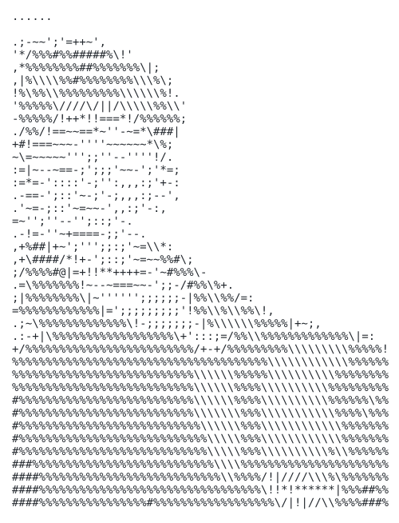

<picture>
  <source media="(prefers-color-scheme: dark)" srcset="dark_mode.svg">
  
</picture>

### ryan ahn

co-founder @ openwm | 17 | seoul

[email](mailto:ryanjmahn1@gmail.com) · [linkedin](https://www.linkedin.com/in/ryan-ahn-57b570440/) · [site](https://ryanjmahn.github.io/)

---

**currently**
- making something people want 

**previously**
- [proteinmpnn](https://github.com/ryanjmahn/ProteinMPNN-Extension) — string matching beat the model 90% vs 28% | co-author · neurips '26 tae (1 of only 3 all-high-school-author paper of 226 accepted (1.33%))
- [dermamnist](https://github.com/ryanjmahn/DermaMNIST-Extension) — downsampling erases 4/5 diagnostic patterns; fix cuts skin-tone gap 52% | co-author · neurips '26 aidar
- [kras g12d](https://github.com/ryanjmahn/KRAS-G12D-SIIP-Benchmark) — pocket predictors hit 0.95 mcc open, collapse closed | solo author · cjsj semi-finalist
- [probix labs](https://tryprobix.com/) — product lab startup for the reproducibility crisis in science research

 

[ryanjmahn.github.io](https://ryanjmahn.github.io/)
